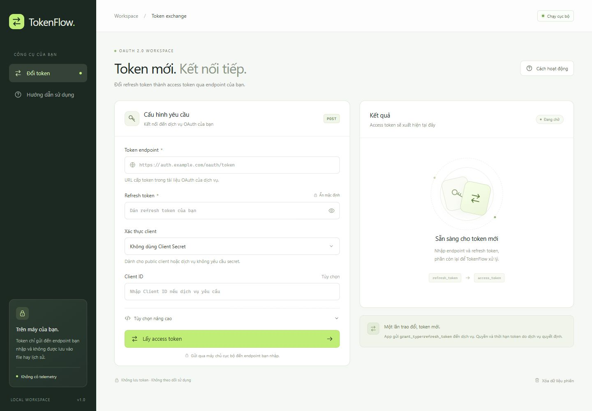

# TokenFlow

App web chạy cục bộ để đổi **refresh token → access token** qua Codex, Google, Microsoft, GitHub App, Discord hoặc token endpoint tùy chỉnh theo OAuth 2.0. Giao diện tiếng Việt, không cần cài thư viện bên ngoài.



## Chạy app

Cần **Node.js 22 trở lên**. Trên Windows, nhấp đúp `start.cmd` để khởi động và mở trình duyệt. Giữ cửa sổ máy chủ mở trong lúc dùng app.

Hoặc chạy trong PowerShell:

```powershell
cd D:\App\TokenFlow
npm start
```

Mở **http://127.0.0.1:3210**. Dùng `npm run open` nếu muốn tự mở trình duyệt. Nhấn `Ctrl+C` trong cửa sổ máy chủ để dừng.

Nếu cổng 3210 đã được sử dụng:

```powershell
$env:PORT = '3211'
npm start
```

## Sử dụng

Chọn **Dịch vụ** để tự điền endpoint và cách xác thực. Mỗi dịch vụ cần refresh token và Client ID của chính ứng dụng đã cấp token. Đổi dịch vụ sẽ xóa token, Client ID, Client Secret, scope, tham số bổ sung và kết quả cũ trong biểu mẫu; không tự gửi yêu cầu.

| Dịch vụ | Token endpoint | Xác thực mặc định |
| --- | --- | --- |
| Codex | `https://auth.openai.com/oauth/token` | Public client mặc định của Codex, tự điền Client ID |
| Google | `https://oauth2.googleapis.com/token` | Client ID + Client Secret trong body |
| Microsoft | `https://login.microsoftonline.com/{tenant}/oauth2/v2.0/token` | Client ID, không dùng secret cho public client |
| GitHub App | `https://github.com/login/oauth/access_token` | Client ID + Client Secret trong body |
| Discord | `https://discord.com/api/oauth2/token` | HTTP Basic với Client ID + Client Secret |

- **Google:** nhập Client ID từ Google Cloud. Nếu loại client gốc không dùng secret, chọn **Không dùng Client Secret**. [Tài liệu Google](https://developers.google.com/identity/protocols/oauth2/web-server#offline).
- **Microsoft:** ô **Tenant Microsoft** mặc định là `common`; có thể dùng `consumers`, `organizations`, Tenant ID hoặc tên miền tổ chức phù hợp với ứng dụng đã đăng ký. Với confidential web client, chọn **Client Secret trong body** và nhập secret. [Tài liệu Microsoft](https://learn.microsoft.com/en-us/entra/identity-platform/v2-oauth2-auth-code-flow#refresh-the-access-token).
- **GitHub App:** cần refresh token của user access token có thời hạn do GitHub App cấp; không áp dụng cho Personal Access Token. Token tạo qua device flow có thể chọn **Không dùng Client Secret**. Dùng Client ID, không dùng App ID. [Tài liệu GitHub](https://docs.github.com/en/apps/creating-github-apps/authenticating-with-a-github-app/refreshing-user-access-tokens).
- **Discord:** cần OAuth2 Client ID và Client Secret gốc; hỗ trợ cả HTTP Basic và secret trong body. [Tài liệu Discord](https://docs.discord.com/developers/topics/oauth2).

Các preset giữ cố định endpoint của dịch vụ; chọn **Endpoint tùy chỉnh** để dùng URL hoặc cấu hình khác, chẳng hạn Microsoft sovereign cloud hoặc GitHub Enterprise. App không hỗ trợ tạo DPoP proof hay xác thực client bằng chứng chỉ/private key.

Với refresh token lấy từ **đăng nhập Codex CLI/app mặc định**, chọn **Dịch vụ → Codex — đăng nhập ChatGPT**. App tự điền:

- Endpoint: `https://auth.openai.com/oauth/token`
- Client ID: `app_EMoamEEZ73f0CkXaXp7hrann`
- Xác thực: **Không dùng Client Secret**

Client ID này là định danh công khai, đã đối chiếu với binary Codex được cài trong môi trường lúc tích hợp. Token thuộc client tùy biến hoặc ứng dụng đăng ký riêng cần **Endpoint tùy chỉnh** và Client ID gốc của phiên đăng nhập. App không tự thử nhiều Client ID hoặc tự gửi lại token.

Với các dịch vụ hoặc client khác:

1. Nhập **Token endpoint** lấy từ tài liệu OAuth của dịch vụ đã cấp refresh token.
2. Dán **Refresh token** của bạn.
3. Chọn cách xác thực mà dịch vụ yêu cầu:
   - **Không dùng Client Secret**: public client; vẫn có thể gửi `client_id`.
   - **Client Secret trong body**: gửi `client_id` và `client_secret` trong form body.
   - **HTTP Basic Authentication**: gửi thông tin client trong header `Authorization` theo RFC 6749 §2.3.1.
4. Nếu cần, mở **Tùy chọn nâng cao** để nhập `scope` hoặc các tham số như `audience`, `resource`.
5. Bấm **Lấy access token**, rồi sao chép kết quả. Token được ẩn mặc định; tab JSON cho phép xem hoặc sao chép các trường token chuẩn.

Khi dịch vụ trả về `refresh_token` mới, app có nút sao chép hoặc điền token mới vào biểu mẫu cho lần tiếp theo. App không tự gửi lại yêu cầu hoặc tự thay token.

**Token endpoint phải dùng HTTPS**; HTTP chỉ được phép với `localhost`, `127.0.0.1` hoặc `[::1]` cho thử nghiệm cục bộ. Token thuộc dịch vụ nào phải gửi tới endpoint của dịch vụ đó.

### Khi gặp `invalid_client` / HTTP 401

Đây là lỗi xác thực client do nhà cung cấp trả về, chưa đủ để kết luận refresh token đã hết hạn. Kiểm tra đúng Client ID của ứng dụng đã cấp token và phương thức xác thực. Nếu đang dùng endpoint OpenAI ở chế độ tùy chỉnh, thông báo lỗi có nút **Điền cấu hình Codex**; nút chỉ điền biểu mẫu, bạn chủ động bấm lấy token để gửi yêu cầu.

Theo [OpenAI Docs: Refresh errors](https://developers.openai.com/siwc/token-sharing-open-source/errors-and-recovery#refresh-errors), `invalid_client` cần sửa cấu hình client; các lỗi như `invalid_grant` hoặc `refresh_token_reused` cần xử lý token/phiên đăng nhập. [Accounts and sessions](https://developers.openai.com/siwc/token-sharing-open-source/profiles-and-sessions#refreshing-tokens) cũng yêu cầu giữ đúng cặp Client ID và bộ token, dùng refresh token mới nhất và tránh refresh đồng thời. Luồng SIWC đăng ký client riêng trong tài liệu này có endpoint và tham số riêng; dùng chế độ tùy chỉnh cho luồng đó.

## Định dạng hỗ trợ

App gửi `POST` với `Content-Type: application/x-www-form-urlencoded`:

```text
grant_type=refresh_token&refresh_token=...&client_id=...
```

Endpoint phải trả về JSON OAuth 2.0 có `access_token`. App nhận các trường chuẩn `token_type`, `expires_in` (giây), `scope`, `refresh_token`, `id_token`. Trường riêng của nhà cung cấp không được đưa vào JSON kết quả. Những dịch vụ dùng JSON request riêng, cookie hoặc định dạng response khác cần được tích hợp riêng.

Đếm ngược thời hạn dựa vào `expires_in` do dịch vụ trả về, tính từ lúc nhận phản hồi; đây là ước tính, không kiểm tra việc thu hồi token tại dịch vụ. App không tự xác minh chữ ký hay giải mã JWT. Nếu thiếu thời hạn, app hiển thị “Không được cung cấp”.

## Dữ liệu và kết nối

- Máy chủ chỉ lắng nghe tại `127.0.0.1`, không mở ra mạng LAN.
- Luồng dữ liệu: **trình duyệt → máy chủ cục bộ → token endpoint bạn nhập**. Máy chủ cục bộ chuyển tiếp yêu cầu để trình duyệt không bị giới hạn CORS của dịch vụ.
- Không ghi token vào file, cookie, localStorage hoặc sessionStorage; không có analytics hay tài nguyên tải từ CDN. Trường “Không lưu token” áp dụng cho app; clipboard và trình quản lý mật khẩu của hệ điều hành/trình duyệt do bạn quản lý.
- “Xóa dữ liệu phiên” hủy yêu cầu đang chờ và xóa biểu mẫu, kết quả trong app. Thao tác này không xóa clipboard, không thu hồi token và không đảm bảo dịch vụ chưa xử lý yêu cầu đã gửi.
- Không ghi log body yêu cầu hay phản hồi chứa token; các lỗi nhà cung cấp được lọc những giá trị nhạy cảm đã biết.
- Không theo chuyển hướng của token endpoint, để tránh chuyển tiếp thông tin xác thực tới URL khác.
- Giới hạn chờ dịch vụ 20 giây, yêu cầu 256 KB, phản hồi 1 MB; chặn yêu cầu web khác nguồn đến API cục bộ.

## Kiểm tra

```powershell
npm run check
npm test
```

Bộ test dùng endpoint giả cục bộ và phản hồi giả lập, không cần refresh token thật, không gọi dịch vụ bên ngoài.

## Cấu trúc

```text
server.js           HTTP server cục bộ, API và bảo vệ nguồn yêu cầu
src/oauth.js        Kiểm tra input, dựng yêu cầu OAuth, xử lý phản hồi
public/             Giao diện HTML / CSS / JavaScript
test/               Kiểm thử bằng node:test
start.cmd           Khởi chạy nhanh trên Windows
```
